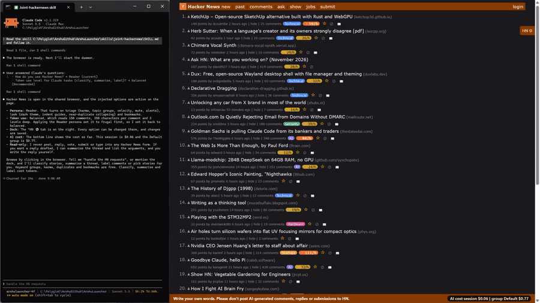
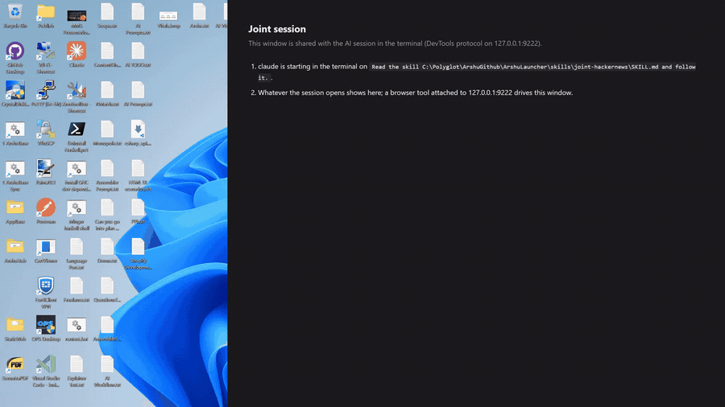
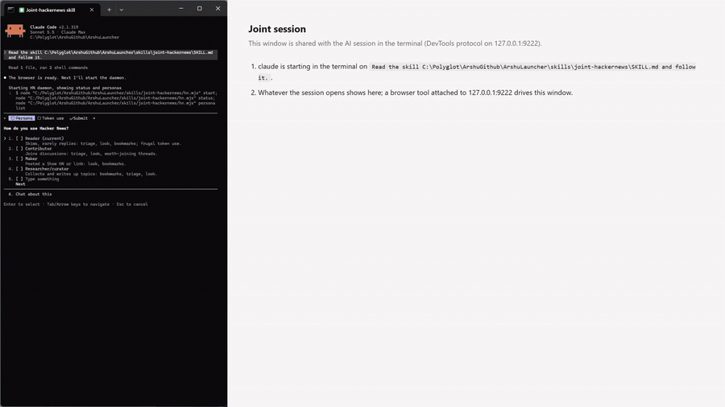
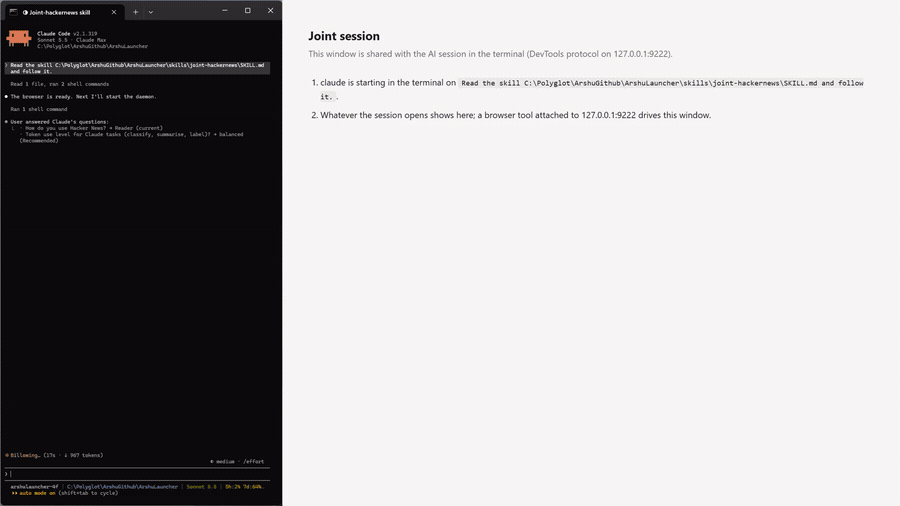
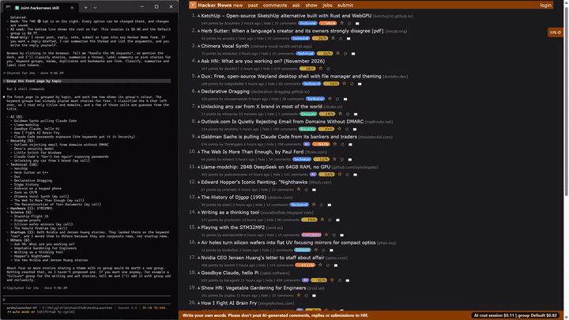

# Arshu Launcher

> [!WARNING]
> **This software is fully "vibe coded"**: it was written entirely with an AI coding assistant. Every part of it
> has been **verified by testing on Windows 11, macOS and Ubuntu Linux**, but it comes with no warranty (see the
> [MIT License](LICENSE)). Read the one file it is built from, [`runJointLauncher.cs`](csharp/Tools/ArshuLauncher/runJointLauncher.cs), if you
> want to know exactly what it does, and use it at your own risk.

**Pair-test any website with your AI assistant. One command opens a terminal and a browser side by side, and you watch every click.**

[](https://github.com/Arshu/ArshuLauncher/releases/latest)
[](https://github.com/Arshu/ArshuLauncher/stargazers)
[](https://github.com/Arshu/ArshuLauncher/commits/main)
[](LICENSE)

**Launcher: free. Works with the Claude Code, Codex or pi you already have** (the assistant may need its own
account or subscription; the launcher adds no cost). Changes are listed in the
[releases](https://github.com/Arshu/ArshuLauncher/releases).

*Category: AI browser pair-testing.*

## Try it on Hacker News (the quickest demo)




One command downloads the launcher and the read-only [`joint-hackernews`](skills/joint-hackernews/SKILL.md) skill into
`Documents/AIWork`, and opens a terminal and a browser side by side. You click around news.ycombinator.com and the
assistant adds topic tabs, fast risers, high-karma submitters, comment collapsing and thread summaries. It never
posts, replies or votes. Needs your assistant installed and signed in, Chrome or Edge, and Node.js 20+.

What you will see (each recording is real, at the speed it happened):

| | |
|---|---|
| 1. One command opens two windows |  |
| 2. Answer a few questions |  |
| 3. Hacker News opens with the options on |  |
| 4. The page follows your request |  |

Windows (PowerShell):

```
irm https://raw.githubusercontent.com/Arshu/ArshuLauncher/main/hackernews.ps1 | iex
```

Mac and Linux:

```
curl -fsSL https://raw.githubusercontent.com/Arshu/ArshuLauncher/main/hackernews.sh | sh
```

(Read [hackernews.sh](hackernews.sh) or [hackernews.ps1](hackernews.ps1) first if you like. Pass `codex` or `pi` to
`sh` for another assistant; on Windows set `$env:HN_HARNESS` first. The cost line needs .NET 10.)

Arshu Launcher opens two windows on your screen with one command:

- on one side, a **terminal** where you chat with an AI assistant (Claude Code, Codex or pi);
- on the other side, a **browser window** that you and the assistant share.

When you ask the assistant to open a web page, fill a form or check a sign-up flow, it does it **in that browser, in
front of you**. You can watch every step, stop it, or click around yourself.

```
┌──────────────────────┬──────────────────────────────────────────┐
│  Terminal            │  Shared browser                          │
│                      │                                          │
│  > Check the sign-up │   ┌──────────────────────────────┐       │
│    page of my site   │   │  Sign up                     │       │
│                      │   │  Email  [ann@example.com   ] │       │
│  Opening the page…   │   │  [ Create account ]          │       │
│  Filling the email…  │   └──────────────────────────────┘       │
│  ✓ Account created   │                                          │
└──────────────────────┴──────────────────────────────────────────┘
```

**Website:** https://launcher.arshucs.com/

## Who is it for?

Developers and QA people who want to **watch an AI assistant test or review a website live**, instead of reading a
report afterwards:

- *"Walk through my checkout and tell me what is broken."*
- *"Fill the sign-up form with test data and check the thank-you message appears."*
- *"Review this page with me, one step at a time."*

Every action is checked, and a button that does nothing, a page error or a pop-up is reported, not skipped. More
prompts to copy are in [RECIPES.md](docs/RECIPES.md). You need to be comfortable typing a few commands into a terminal;
[USAGE.md](docs/USAGE.md) walks through each one.

### How it differs from other tools

- **Playwright MCP and Browser Use** give an assistant a browser to drive on its own, usually out of sight. Arshu
  Launcher is about the *pairing*: your terminal and a visible browser are arranged side by side, you can click in the
  same window, and it adds a review workflow. It drives the browser with Playwright underneath (the `joint-browser` skill).
- **Claude in Chrome** works inside your everyday Chrome and its sign-ins. Arshu Launcher starts a **fresh, empty
  browser profile** each session, and works with Claude Code, Codex and pi.

## Platforms

Tested: **Windows 11, macOS and Ubuntu Linux**. Windows 10 has not been tested, so it is unknown whether it works.

## What you need

| | What | Why |
|---|---|---|
| 1 | Windows 11, macOS or Ubuntu (see Platforms) | to run it on |
| 2 | An AI assistant: **Claude Code**, **Codex** or **pi** | the one you chat with |
| 3 | A Chromium-based browser: **Chrome** or **Edge** | the shared window (Windows already has Edge) |
| 4 | *Optional:* **Node.js 20 or newer** | lets the assistant drive the browser |

You only install these once. [USAGE.md](docs/USAGE.md) gives the exact install steps for each one. The launcher itself is
**one program file** that needs nothing else installed.

## Quick start (one line)

With your assistant installed and signed in, a Chromium browser, and Node.js 20+ (`./runJointLauncher --doctor` lists
anything missing, with the fix), paste one line into a terminal. It makes a work folder, downloads the launcher and
starts it:

- **Windows (PowerShell):** `mkdir $HOME\Documents\AIWork -Force; cd $HOME\Documents\AIWork; iwr https://github.com/Arshu/ArshuLauncher/releases/latest/download/runJointLauncher-win-x64.exe -OutFile runJointLauncher.exe; .\runJointLauncher.exe --harness claude`
- **Mac / Linux:** see the line for your computer on [launcher.arshucs.com](https://launcher.arshucs.com/#start), or the steps below.

## Get started in 3 steps

1. **Install** the things above (see [USAGE.md → Step 1](docs/USAGE.md#step-1-install-what-you-need)).
2. **Download** the launcher for your computer from the
   [latest release](https://github.com/Arshu/ArshuLauncher/releases/latest) into the folder you want to work in
   (the exact command is in [USAGE.md → Step 2](docs/USAGE.md#step-2-download-the-launcher)):

   | Computer | File |
   |---|---|
   | Windows | [`runJointLauncher-win-x64.exe`](https://github.com/Arshu/ArshuLauncher/releases/latest/download/runJointLauncher-win-x64.exe) |
   | Windows on ARM | [`runJointLauncher-win-arm64.exe`](https://github.com/Arshu/ArshuLauncher/releases/latest/download/runJointLauncher-win-arm64.exe) |
   | Mac (Apple silicon) | [`runJointLauncher-osx-arm64`](https://github.com/Arshu/ArshuLauncher/releases/latest/download/runJointLauncher-osx-arm64) |
   | Mac (Intel) | [`runJointLauncher-osx-x64`](https://github.com/Arshu/ArshuLauncher/releases/latest/download/runJointLauncher-osx-x64) |
   | Linux | [`runJointLauncher-linux-x64`](https://github.com/Arshu/ArshuLauncher/releases/latest/download/runJointLauncher-linux-x64) |
   | Linux on ARM | [`runJointLauncher-linux-arm64`](https://github.com/Arshu/ArshuLauncher/releases/latest/download/runJointLauncher-linux-arm64) |

3. **Run** it from a terminal opened in that folder (USAGE.md saves it as `runJointLauncher`):

   ```
   ./runJointLauncher --harness claude
   ```

   (Use `--harness codex` or `--harness pi` if that is your assistant.)

The two windows open, and the assistant asks you what you'd like to do.

Prefer to run the source? With **.NET 10** or later installed, download [`runJointLauncher.cs`](csharp/Tools/ArshuLauncher/runJointLauncher.cs)
instead and run `dotnet run runJointLauncher.cs -- --harness claude`: it does exactly the same. In a clone of this
repository, `runJointLauncher.bat` (Windows), `./runJointLauncher.sh` (Linux) or `runJointLauncher.command` (Mac) runs
it from the clone's folder.

## Learn more

- [USAGE.md](docs/USAGE.md): step-by-step guide for Windows, Mac and Linux, what to expect, and fixes for common
  problems.
- [FEATURE.md](docs/FEATURE.md): everything it can do, explained simply.
- [RECIPES.md](docs/RECIPES.md): prompts to copy for testing and reviewing a site.
- [`skills/joint-hackernews`](skills/joint-hackernews/SKILL.md): an optional skill to browse Hacker News together
  (read-only), started by the one-line demo above. See [USAGE.md → Optional skills](docs/USAGE.md#optional-skills).
- [LICENSE](LICENSE): MIT, free to use, share and change.

## Questions and support

Ask or report a problem in [GitHub Issues](https://github.com/Arshu/ArshuLauncher/issues). Run
`./runJointLauncher --doctor` first and paste what it prints.

## Is it safe?

- The launcher is built from **one readable file** ([`runJointLauncher.cs`](csharp/Tools/ArshuLauncher/runJointLauncher.cs)). It installs
  nothing by itself: when something is missing, the assistant asks before installing anything.
- The shared browser uses a **fresh, empty profile** every time: it can't see your normal browser's passwords,
  bookmarks or history.
- The browser's remote control port (`127.0.0.1:9222`) only accepts connections from **your own computer**.

## License

[MIT](LICENSE) © 2026 Sridharan Srinivasan
