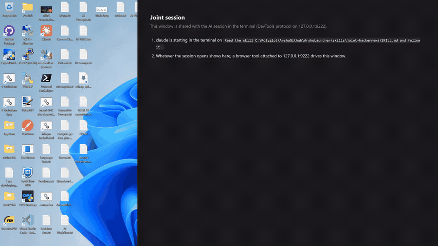
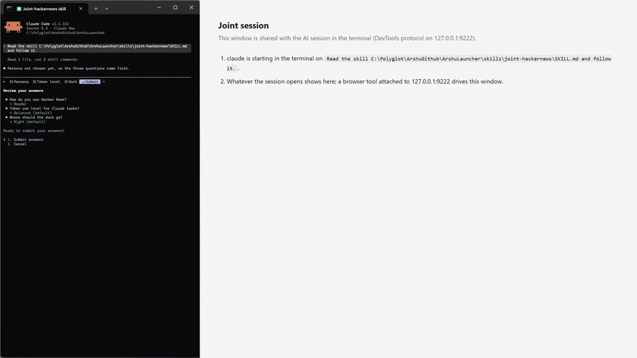
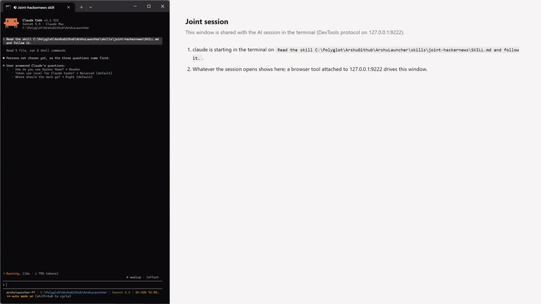

# 01 Persona and launch

## What it does
You start a session with `--skill joint-hackernews`. The skill opens Hacker News in the shared browser and asks three first-run questions: who you are on Hacker News (persona), how many tokens Claude may spend on reading tasks, and which side of the page the dock goes on. The persona is picked once and then fixed.

## Who gets it
All four personas: Reader, Contributor, Maker, Researcher. The persona is chosen once and cannot be changed (a second `persona choose` is refused; the dock has no switch). Only `hn.mjs reset`, which wipes all options, starts over.

## Cost
Free. Answering the questions costs only the normal conversation tokens Claude uses to ask them.

## How to verify
1. Launch with `--skill joint-hackernews` and wait for Claude to ask. Expected: three questions in this order: "How do you use Hacker News?" (Reader, Contributor, Maker, Researcher/curator), "Token use level for Claude tasks?" (Frugal, Balanced, Thorough), "Where should the dock go?" (Right, Left, Top, Bottom).
2. Answer them and let Claude open news.ycombinator.com. Expected: the page loads with an orange "HN ⚙" tab and an orange footer bar.
3. Click the "HN ⚙" tab. Expected: the dock header reads "Joint Hacker News · <your persona>".
4. Ask Claude to change the persona. Expected: Claude declines (the command refuses: "the persona is already chosen ... and cannot be changed").
5. In a fresh state, before a persona is chosen, the dock itself shows "How do you use Hacker News? Pick once; it cannot be changed afterwards." with one button per persona.

## What must NOT happen
Nothing is written to Hacker News: no post, comment, reply, vote, favourite, flag, hide, submit or login, and no text typed into an HN form. The skill only restyles the page in your browser and keeps local files in `~/.joint-hackernews/`. The persona cannot be switched after the first choice.

## Evidence

[video](media/hn-01-launch.mp4)

[video](media/hn-01-opens.mp4)

Recording: recorded 2026-11-10 with the Reader persona by runToolsRecord; the automated test has not run yet

## Automated check
Section `persona-and-launch` of the case `hackernews-features` in runToolsLocal: asserts the persona is stored, the dock shows the chosen persona's title, and a second choice is refused.
