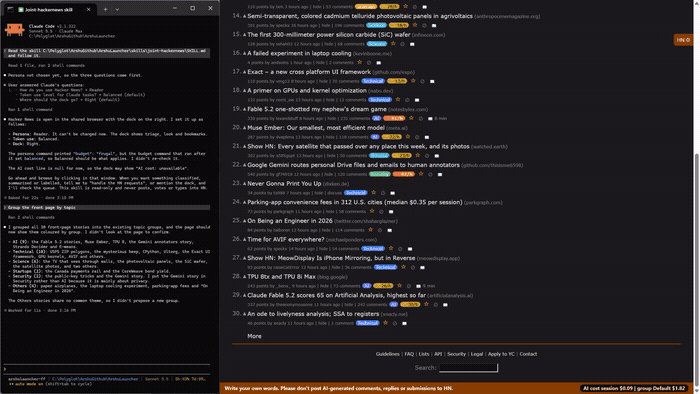

# 02 Dock

## What it does
The "HN ⚙" tab opens a panel (the dock) beside the page with the options for your persona. You can move it right, left, top or bottom. It shows only the sections your persona needs, so it stays small.

## Who gets it
All four personas, each with its own sections (from modules.json):
- Reader: stories (triage), look, bookmarks. Starts at the frugal token level.
- Contributor: stories (triage), look, worth joining.
- Maker: look, bookmarks.
- Researcher: bookmarks, stories (triage), look.

The persona is chosen once and cannot be changed.

## Cost
Free.

## How to verify
1. Click "HN ⚙". Expected: the panel opens; click again and it closes (the state is remembered in the browser).
2. Change "Dock" to left, top, bottom, then right. Expected: the panel and tab move to that side each time.
3. With a story list open, look at the sections. Expected for Reader, Contributor, Researcher: "Look" and "Stories" with "Topics"; for Maker: "Look" and Bookmarks only.
4. Open a discussion page (click "comments"). Expected: Look adds Indent guides, Highlight the poster, Collapse near-duplicates; "Claude on this thread" appears only for Reader, Contributor, Researcher.
5. Check "Bookmarks" is present for Reader, Maker, Researcher and absent for Contributor; "Worth joining" only for Contributor.
6. Narrow the window below 700 px. Expected: the dock becomes a bottom sheet.

## What must NOT happen
Nothing is written to Hacker News: no post, comment, reply, vote, favourite, flag, hide, submit or login, and no text typed into an HN form. Changing a dock option only changes the local options file in `~/.joint-hackernews/`.

## Evidence

[video](media/hn-02-dock.mp4)

Recording: recorded 2026-11-10 with the Reader persona by runToolsRecord; the automated test has not run yet

## Automated check
Section `dock` of the case `hackernews-features` in runToolsLocal: asserts the dock's sections for the chosen persona (present and absent) and the position class after changing the dock side.
