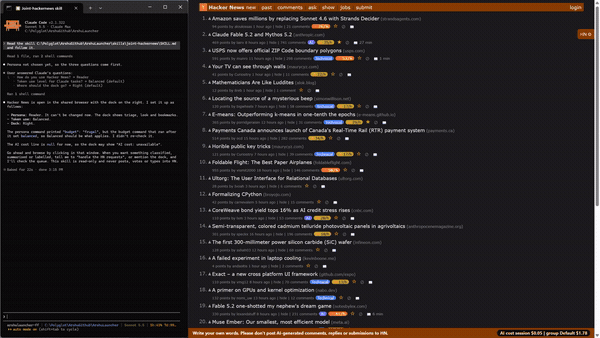

# 03 Front-page signals

## What it does
On a story list the skill marks what you would otherwise have to work out yourself. Submitters with a high karma (10,000 or more by default) get a coloured edge and a badge with their karma. Stories gaining points quickly get a lightning badge with points per hour. Stories not on the page at your last visit get "NEW". Stories you already opened are dimmed.

## Who gets it
The "Stories" toggles belong to the triage module: Reader, Contributor, Researcher. Maker does not get these toggles. The persona is chosen once and cannot be changed.

## Cost
Free. Karma is looked up from Hacker News's public API by the local daemon; no Claude tokens.

## How to verify
1. Open the front page. Expected: some rows have a badge "<user> <karma>" (for example "12k"); the colour is stronger at 5 and 10 times the threshold.
2. Look for "⚡N/h" badges. Expected: shown when a story is older than 15 minutes and gains at least 10 points per hour; orange and bold at 40 per hour or more. Hover shows the post time.
3. Reload after a while (a visit ends after 30 quiet minutes). Expected: new stories carry a teal "NEW" badge and the tab shows "✦N". The very first run only seeds the list, so nothing is NEW then.
4. Click a story title and go back. Expected: that row is dimmed.
5. In the dock untick each of the four toggles. Expected: the matching marks disappear.

## What must NOT happen
Nothing is written to Hacker News: no post, comment, reply, vote, favourite, flag, hide, submit or login, and no text typed into an HN form. Karma lookups only read public profile data; the seen and NEW lists live in your browser.

## Evidence

[video](media/hn-03-signals.mp4)

Recording: recorded 2026-11-10 with the Reader persona by runToolsRecord; the automated test has not run yet

## Automated check
Section `front-page-signals` of the case `hackernews-features` in runToolsLocal: asserts karma badges, velocity badges, NEW marks after a second visit, and the dimmed class on an opened story, each by counting elements.
