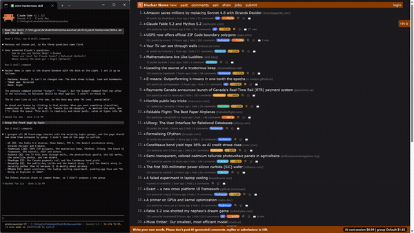
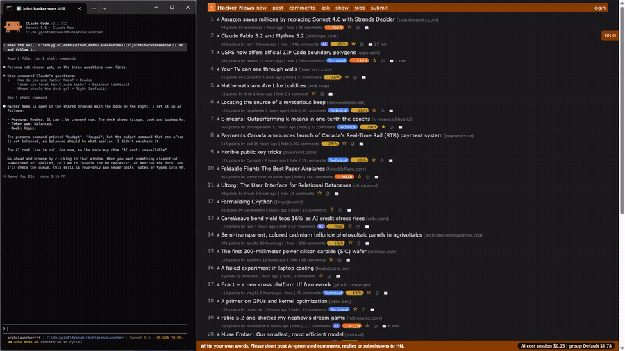

# 04 Topic groups

## What it does
Every story is put in a topic group (AI, Startups, Security, Politics, Technical, Science, or Others) by keywords and domains, and gets a coloured badge. Chips in the dock show how many stories each group has; clicking a chip shows only that group. If you ask, Claude can classify the stories the keywords missed.

## Who gets it
Chips and the classify button are in the Stories section (triage): Reader, Contributor, Researcher. The persona is chosen once and cannot be changed. The classify button is hidden at the Frugal token level (Reader starts there).

## Cost
Keyword groups and chips: free. "Ask Claude to classify": tokens by Claude; the dock shows the estimate ("reads ≈ N tokens") and the cost bar then rises.

## How to verify
1. Open the front page. Expected: stories that match a group show a coloured badge and a tinted row.
2. Under "Topics" read the chips, for example "AI · 4". Expected: the counts match the badges on the page.
3. Click the "AI" chip. Expected: only AI stories remain; click again to show all.
4. Switch the token use to Balanced, click "Ask Claude to classify", then tell Claude "handle the HN requests". Expected: the footer first says a request is waiting; afterwards re-grouped stories carry Claude's group badge.

## What must NOT happen
Nothing is written to Hacker News: no post, comment, reply, vote, favourite, flag, hide, submit or login, and no text typed into an HN form. Groups are stored only in the local options file; classifying never touches the site.

## Evidence

[video](media/hn-04-groups.mp4)

[video](media/hn-04-classify.mp4)

Recording: recorded 2026-11-10 with the Reader persona by runToolsRecord; the automated test has not run yet

## Automated check
Section `topic-groups` of the case `hackernews-features` in runToolsLocal: asserts group badge counts equal chip counts, that a chip click hides other groups and a second click restores them, and that the classify click queues a request.
