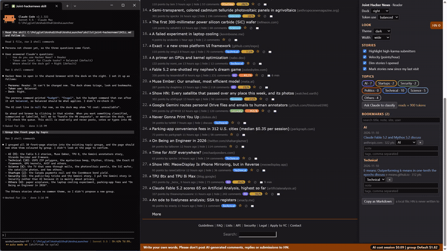

# 05 Article summary

## What it does
The 📖 on a story row asks Claude to read the linked article and give a short summary. The row immediately shows "⏳ queued" and the footer tells you to say "handle the HN requests" to Claude. After Claude has read the article, the row shows "📖 N min" (reading time) and the summary appears as the tooltip.

## Who gets it
The 📖 is on every story row that links to an outside site, and on the discussion header, for all four personas: Reader, Contributor, Maker, Researcher. The persona is chosen once and cannot be changed.

## Cost
Tokens by Claude. The 📖 tooltip shows the estimate by token level (about 750 frugal, 1.5k balanced, 3k thorough). Claude should say this before fetching.

## How to verify
1. Hover a 📖 on a row. Expected: the tooltip "ask Claude to summarise this article (≈ N tokens)".
2. Click it. Expected: the badge becomes "⏳ queued" and the footer says a request is waiting: tell Claude "handle the HN requests".
3. Tell Claude "handle the HN requests". Expected: Claude fetches the story's own link and annotates it.
4. Look at the row. Expected: "📖 N min"; hover shows the summary (at most 500 characters). If the page was cut short Claude says so; for a PDF, paywall or video Claude says why it cannot, and does not guess.

## What must NOT happen
Nothing is written to Hacker News: no post, comment, reply, vote, favourite, flag, hide, submit or login, and no text typed into an HN form. Only the story's own public link is fetched by the local daemon, never a private address.

## Evidence

[video](media/hn-05-article.mp4)

Recording: recorded 2026-11-10 with the Reader persona by runToolsRecord; the automated test has not run yet

## Automated check
Section `article-summary` of the case `hackernews-features` in runToolsLocal: asserts the click produces the queued badge and the footer notice, that the request appears in the requests list, and that after annotation the row text is "📖 N min" with the summary as its title.
