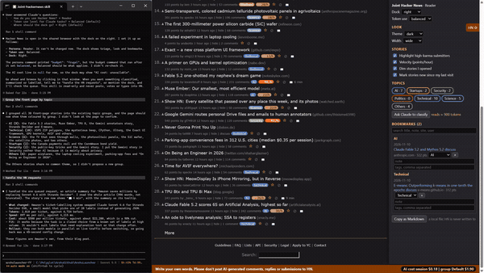

# 06 Thread reading

## What it does
On a discussion page the skill draws vertical guide lines for each reply level, marks the original poster's comments with an orange edge, folds comments that nearly repeat an earlier one into a one-line stub, and offers a dark or sepia theme.

## Who gets it
The Look section is in every persona: Reader, Contributor, Maker, Researcher. Its defaults are dark theme, wide layout, guides, OP highlight and repeat-collapsing. The persona is chosen once and cannot be changed.

## Cost
Free. All of it is computed in the page; no Claude call.

## How to verify
1. Open a discussion with many replies. Expected: faint vertical lines at each indent level.
2. Find a comment by the poster of the story. Expected: an orange bar at its left edge.
3. Look for "collapsed: repeat – near-duplicate of <user>'s earlier comment [show]" (needs a comment of at least 12 words sharing 60% of its words with an earlier one). Click "show". Expected: the comment opens and the link reads "hide".
4. In the dock change Theme to sepia, then default. Expected: the page recolours each time.
5. Untick Indent guides, Highlight the poster, Collapse near-duplicates. Expected: each effect disappears.

## What must NOT happen
Nothing is written to Hacker News: no post, comment, reply, vote, favourite, flag, hide, submit or login, and no text typed into an HN form. Collapsed comments are only hidden in your view; nothing is reported or flagged on HN.

## Evidence

[video](media/hn-06-thread.mp4)

Recording: recorded 2026-11-10 with the Reader persona by runToolsRecord; the automated test has not run yet

## Automated check
Section `thread-reading` of the case `hackernews-features` in runToolsLocal: asserts the guides class, the OP highlight class on the poster's rows, a collapsed stub for a near-duplicate with its show link toggling, and the theme class for dark and sepia.
