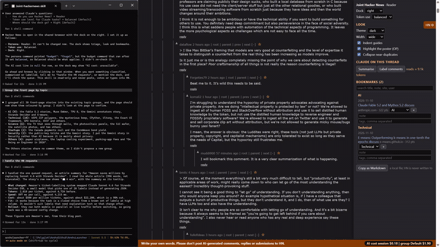

# 07 Thread summary

## What it does
The Summarise button asks Claude to read a discussion and write the main positions, where people disagree and which comments are worth reading. The summary box appears above the comments. Each position links to the comments it is based on; clicking a link scrolls to that comment and flashes it.

## Who gets it
The button is in "Claude on this thread" (triage): Reader, Contributor, Researcher. Maker does not get it. The persona is chosen once and cannot be changed.

## Cost
Tokens by Claude. The dock shows "reads ≈ N tokens" next to the button; how much of the thread is read depends on the token level (frugal 60 comments, balanced 150, thorough 400).

## How to verify
1. Open a discussion page. Expected: "Claude on this thread" with Summarise, Label comments and a token estimate.
2. Click Summarise. Expected: the footer reports a request waiting.
3. Tell Claude "handle the HN requests". Expected: a box "Discussion summary" appears above the comments.
4. Click a name link in a position. Expected: the page scrolls to that comment and it flashes orange.
5. Read the last line of the box. Expected: "Written by Claude from X of Y comments at <time>. It can be wrong: check the comments it cites." X is smaller than Y when the thread was truncated.

## What must NOT happen
Nothing is written to Hacker News: no post, comment, reply, vote, favourite, flag, hide, submit or login, and no text typed into an HN form. The summary is a reading aid; the skill does not write a reply for you.

## Evidence

[video](media/hn-07-summary.mp4)

Recording: recorded 2026-11-10 with the Reader persona by runToolsRecord; the automated test has not run yet

## Automated check
Section `thread-summary` of the case `hackernews-features` in runToolsLocal: asserts the click queues a summary request, that an annotated summary renders the box with its jump links, that a link click flashes the target, and that the "X of Y comments" line is present.
