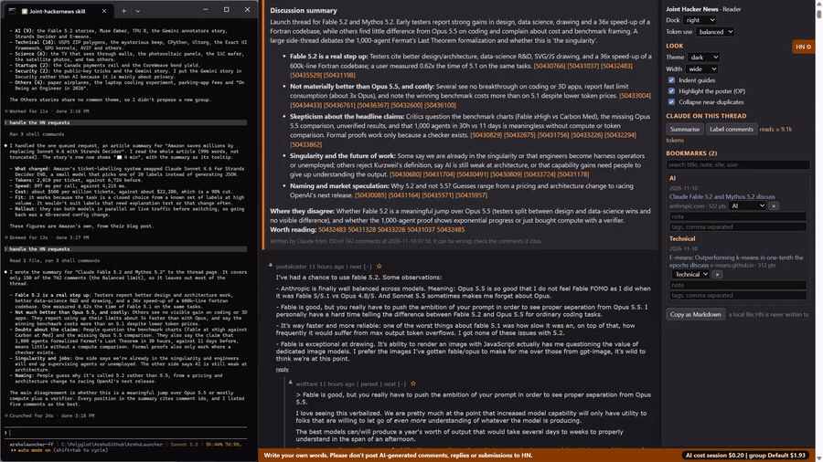

# 08 Label comments

## What it does
"Label comments" asks Claude to judge the tone of each comment (personal attack, snark, low value, repeat, or substantive). Labelled comments are folded to a one-line stub with a "show" link; substantive ones get a green edge and a "★ substantive" badge. Nothing is deleted.

## Who gets it
The button is in "Claude on this thread" (triage): Reader, Contributor, Researcher. The persona is chosen once and cannot be changed.

## Cost
Tokens by Claude; the estimate is shown next to the button.

## How to verify
1. Open a discussion and click "Label comments". Expected: a request is waiting in the footer.
2. Tell Claude "handle the HN requests". Expected: some comments become "collapsed: <reason> – <why> [show]".
3. Know the sensitivity: by default (level 1) only personal attacks and repeats collapse; snark collapses at level 2 and low substance at level 3. The level is set with `hn.mjs set discussion.labels`, not in the dock.
4. Click "show" on a stub. Expected: the comment text appears.
5. Find a "★ substantive" badge and hover it. Expected: the reason Claude gave.

## What must NOT happen
Nothing is written to Hacker News: no post, comment, reply, vote, favourite, flag, hide, submit or login, and no text typed into an HN form. Labels judge the comment's tone, not the person; collapsing is only in your view and nothing is reported to HN.

## Evidence

[video](media/hn-08-labels.mp4)

Recording: recorded 2026-11-10 with the Reader persona by runToolsRecord; the automated test has not run yet

## Automated check
Section `label-comments` of the case `hackernews-features` in runToolsLocal: asserts the click queues a labels request and that annotated attack, snark and low-value comments are collapsed according to the sensitivity level, with a working show link.
