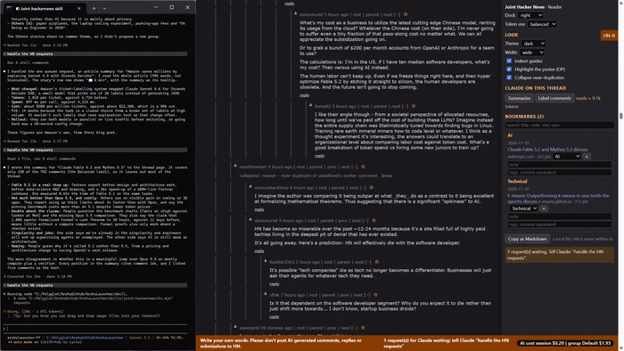

# 09 Bookmarks

## What it does
A ☆ on every story, discussion header and comment saves it to a local file. The dock lists saved items grouped by topic group and then by the day saved, with a note and tags for each, a search box, a way to move an item to another group, and "Copy as Markdown".

## Who gets it
Reader, Maker, Researcher. The Contributor's dock has no Bookmarks section. The persona is chosen once and cannot be changed.

## Cost
Free. (A written digest of your bookmarks, if you ask Claude for one, costs tokens by Claude; Claude says so first.)

## How to verify
1. Click ☆ on a story and on a comment. Expected: both turn ★; the dock heading shows "Bookmarks (2)".
2. Open the dock. Expected: entries under their topic group and under the date; comments are marked 💬.
3. Type a note and tags into an entry and press Tab. Expected: they are kept after a reload.
4. Type part of a title in the search box. Expected: only matching entries show.
5. Click "Copy as Markdown" and paste somewhere. Expected: a Markdown list of links with points and discussion links.
6. Click × on an entry. Expected: it is removed and the ★ returns to ☆.

## What must NOT happen
Nothing is written to Hacker News: no post, comment, reply, vote, favourite, flag, hide, submit or login, and no text typed into an HN form. A bookmark is not an HN favorite; the data is in the local file `~/.joint-hackernews/bookmarks.json`.

## Evidence

[video](media/hn-09-bookmarks.mp4)

Recording: recorded 2026-11-10 with the Reader persona by runToolsRecord; the automated test has not run yet

## Automated check
Section `bookmarks` of the case `hackernews-features` in runToolsLocal: asserts star toggling, grouping of entries, note and tags persisting, search filtering, removal, and the Markdown text from the bookmarks command.
