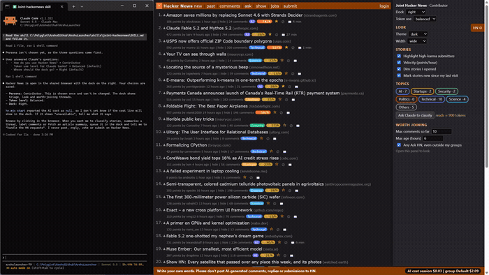

# 10 Worth joining

## What it does
Lists up to 8 threads that are still early and quiet (by default under 6 hours old and at most 10 comments) in your topic groups, plus Ask HN posts nobody has answered. Each shows its group, age, comment count and points, and links to the thread. It only finds the thread; you write your own words.

## Who gets it
Contributor only. The persona is chosen once and cannot be changed.

## Cost
Free. The local daemon reads Hacker News's public search (Algolia), cached for 5 minutes; no Claude tokens.

## How to verify
1. As a Contributor open the dock. Expected: a "Worth joining" section with "Max comments so far" (10), "Max age (hours)" (6) and "Any Ask HN, even outside my groups".
2. Wait a moment. Expected: a list with age, "no comments yet" or a count, points, and "Ask HN", "Show HN" or the site.
3. Click one title. Expected: that discussion opens.
4. Lower Max comments to 0. Expected: only unanswered threads remain, or the message "Nothing early and quiet in your groups right now".
5. Click Refresh. Expected: the list reloads.

## What must NOT happen
Nothing is written to Hacker News: no post, comment, reply, vote, favourite, flag, hide, submit or login, and no text typed into an HN form. The skill does not draft or post a reply; the search is a read of public data.

## Evidence

[video](media/hn-10-joining.mp4)

Recording: recorded 2026-11-10 with the Contributor persona by runToolsRecord (also the Contributor launch: media/hn-10-launch.gif, media/hn-10-persona.gif, media/hn-10-opens.gif); the automated test has not run yet

## Automated check
Section `worth-joining` of the case `hackernews-features` in runToolsLocal: asserts the section exists for the Contributor only, that listed items respect the age and comment limits, and that changing the limits changes the list.
