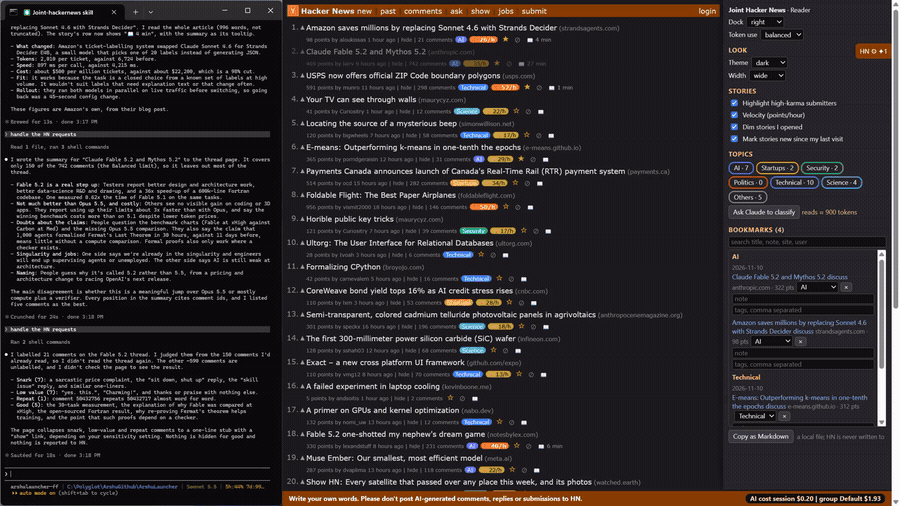

# 11 Cost and guard

## What it does
A bar at the bottom of every Hacker News page always shows the AI cost: this session's spend and the session group's spend. If the cost cannot be read it says "AI cost: unavailable" instead of showing a made-up number. The bar also carries the notice "Write your own words. Please don't post AI-generated comments, replies or submissions to HN."

## Who gets it
All four personas: Reader, Contributor, Maker, Researcher. The persona is chosen once and cannot be changed.

## Cost
Free to show. It reports what Claude work (classify, article, summary, labels and the conversation itself) has cost.

## How to verify
1. On any HN page read the footer. Expected: "AI cost  session $x.xx  |  group G $y.yy" and the notice.
2. Hover the cost. Expected: a tooltip; a "*" after the amounts means an estimate using a default price (the tooltip names it).
3. Run one Claude task from the dock (for example Summarise) and handle it. Expected: the amounts rise.
4. Ask Claude to post a reply for you. Expected: it declines and offers to summarise the thread instead.
5. Run `node hn.mjs help`. Expected: it ends with "There is no command that posts, comments, replies, votes, flags or submits, by design."

## What must NOT happen
Nothing is written to Hacker News: no post, comment, reply, vote, favourite, flag, hide, submit or login, and no text typed into an HN form. The `open` command goes only to https://news.ycombinator.com pages. This is a good-faith guard, not a security boundary.

## Evidence

[video](media/hn-11-cost.mp4)

Recording: recorded 2026-11-10 with the Reader persona by runToolsRecord; the automated test has not run yet

## Automated check
Section `cost-and-guard` of the case `hackernews-features` in runToolsLocal: asserts the footer cost text format and the notice text on a list page and a discussion page, and that the help text and the open command refuse any write or non-HN page.
